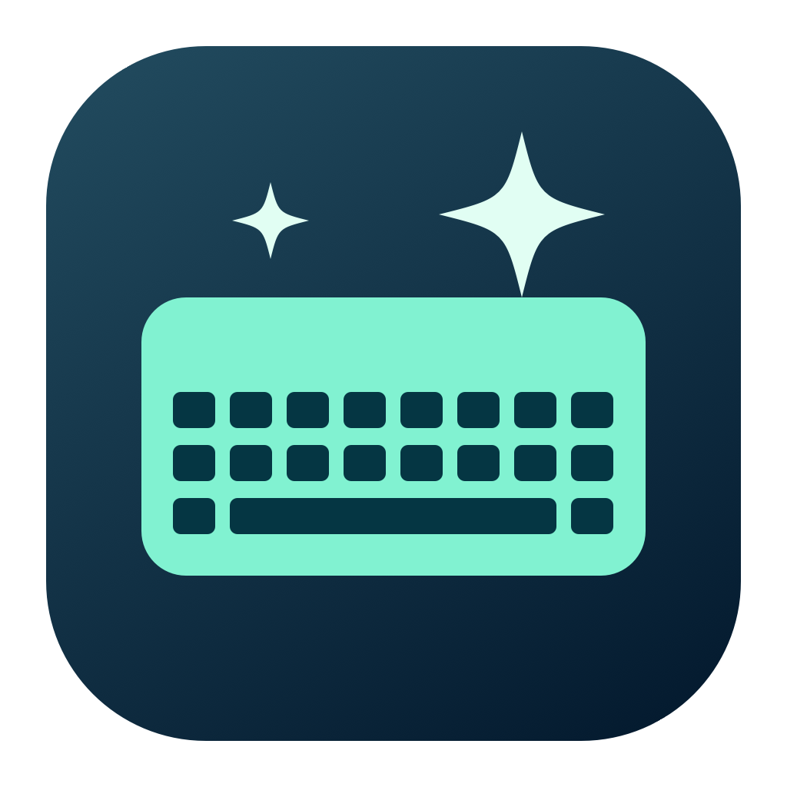

# KeySpa

**Lock your keyboard. Wipe it clean. Get back to work.**

KeySpa lives in your Mac’s menu bar and pauses keyboard input while you clean. Your mouse and trackpad keep working, so you can unlock whenever you’re ready. No countdown. No account. No subscription.

[**Download KeySpa for Mac**](https://github.com/EXTREMOPHILARUM/KeySpa/releases/latest)

Requires **macOS 14 Sonoma or later**. Supports **Apple Silicon and Intel** Macs. Free and open source.

## Install

1. Download the **`.dmg`** file from the latest release.
2. Open it and drag **KeySpa** into **Applications**.
3. Eject the disk image, then open KeySpa from Applications.
4. Look for the **keyboard icon in your menu bar**. KeySpa doesn’t appear in the Dock.

Releases are signed with Developer ID and notarized by Apple.

## Clean your keyboard

1. Click the keyboard icon in the menu bar.
2. Click **Lock keyboard**. On first use, allow KeySpa in **System Settings → Privacy & Security → Accessibility**, then try Lock again.
3. Wipe your keyboard.
4. Use your mouse or trackpad to click the menu bar icon, then **Unlock keyboard**.

The keyboard stays locked until you unlock it. Quitting KeySpa or putting your Mac to sleep also releases the lock. If macOS interrupts the lock, KeySpa shows a message; lock again before continuing to clean.

**Keep clear of the power / Touch ID button.** KeySpa is a cleaning aid, and some hardware buttons or system-reserved shortcuts may still respond.

## Your typing stays yours

KeySpa doesn’t record keystrokes, send your typing anywhere, or collect analytics. Accessibility permission lets it block keyboard input while cleaning. It doesn’t require an account or an internet connection to use.

## Need a hand?

**I don’t see an app window.** Click the keyboard icon in the menu bar; KeySpa has no Dock icon.

**Accessibility is enabled, but KeySpa still asks.** Quit KeySpa. In Accessibility settings, remove the old KeySpa entry, add the copy in Applications, and enable it. Then reopen KeySpa and try again. This can happen when switching from a development build.

**How do I uninstall it?** Quit KeySpa from its menu, then move it from Applications to the Trash.

Found a problem? [Open an issue](https://github.com/EXTREMOPHILARUM/KeySpa/issues/new) with your macOS version and what happened. Please don’t include passwords or private typing.

## Open source

KeySpa is MIT licensed. Contributions are welcome. See the [developer guide](development.md) to build it yourself, or the [release guide](releases.md) for signing and publishing.
